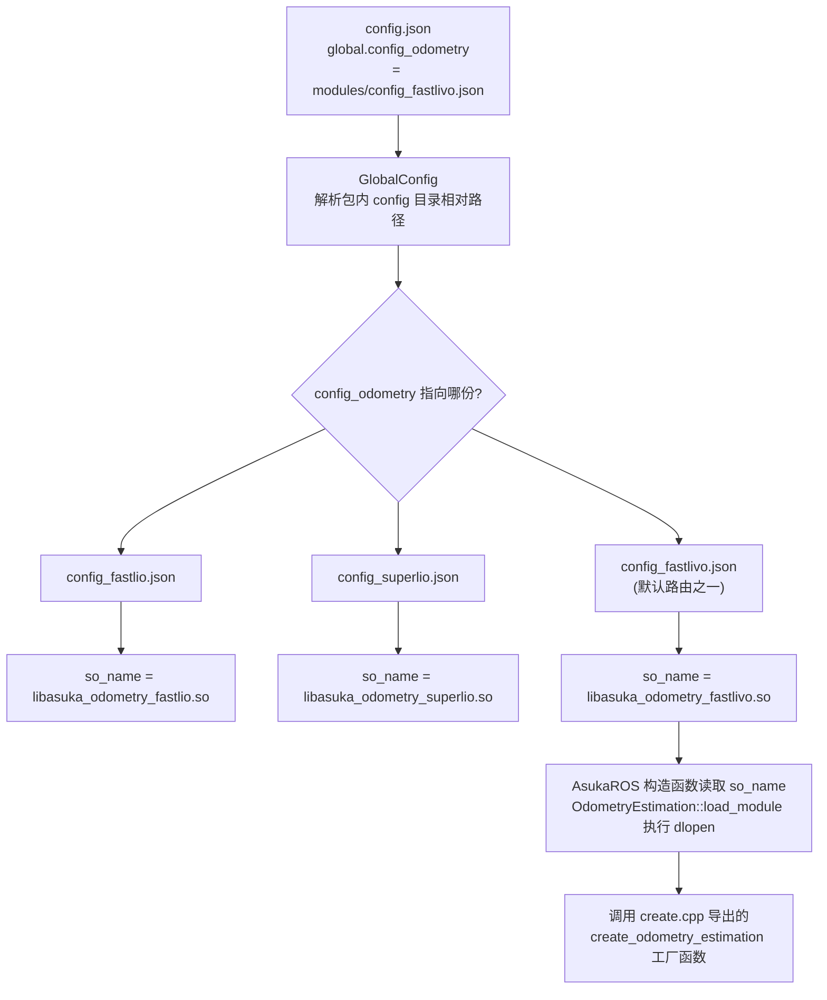

# 里程计配置变体与实现切换

## 页面定位

`src/asuka/config/modules/` 目录下存放三种现役里程计算法各自的参数文件，**一种算法对应一份独立 JSON**。这些文件是「算法矩阵」的参数边界：文件内 `odometry.so_name` 指明该算法编译出的动态库名，其余分段收纳各算法私有的超参。而顶层 `config.json` 的 `global.config_odometry` 键决定运行时读取哪一份——**更换里程计实现只需修改这一行指向**。

## 配置文件清单

| 文件 | 体量 | 顶层分段 | so_name |
|---|---|---|---|
| `config_fastlio.json` | 1051 B / 66 行 | odometry / preprocess / mapping / filter / sensor | `libasuka_odometry_fastlio.so` |
| `config_superlio.json` | 1390 B / 85 行 | odometry / kf / imu / hash_map / preprocess / extrinsic / eva / sensor | `libasuka_odometry_superlio.so` |
| `config_fastlivo.json` | 2416 B / 140 行 | odometry / preprocess / imu / lio / vio / time_offset / mapping / publish / sensor / camera | `libasuka_odometry_fastlivo.so` |

三份文件共同构成一个「最小公共契约 + 算法私有命名空间」的结构（体量为 2026-10-27 现值）。

## 公共契约：`odometry` 分段

三份配置的 `odometry` 分段都以 `so_name` 为锚：

- **`so_name`**：动态库文件名，是 `OdometryEstimation::load_module` 执行 `dlopen` 的目标，也是整个切换机制的锚点；
- **`imu_buffer_capacity: 1000`**、**`lidar_buffer_capacity: 50`**：各算法插件**内部**环形缓冲的容量（异步执行器自身的两条环形缓冲容量为固定常量 1000/50，不经配置）。

除此之外，`odometry` 分段在不同文件中的「占用程度」差异明显：fastlio 在其中放了 `max_iteration: 3`、`laser_point_cov: 0.001`；而 superlio / fastlivo 的 `odometry` 分段只保留公共三元组，算法参数下沉到各自命名段。

## 各算法配置剖面

### fastlio：最紧凑的一份
预处理 `scan_line: 4`、`point_filter_num: 3`，配准侧仅 `fov_degree: 360` 与体素滤波参数（`filter_size_surf: 0.15`、`filter_size_map: 0.25`、`cube_side_length: 1000`）；`sensor` 块携带雷达-IMU 外参。

### superlio：算法参数按语义分组
`kf`（迭代上限与收敛阈值）、`imu`（重力与噪声）、`hash_map`（八叉体素地图容量与分辨率）、`preprocess`（距离窗/抽稀/`enable_downsample`/体素尺寸）、`eva`（计时开关）、`extrinsic`（机器人安装角）各自独立成段；`sensor` 块携带雷达-IMU 外参。

### fastlivo：体量最大的一份
140 行中 `lio` 段收纳稀疏体素八叉树地图全套参数（`max_layer`、`dept_err`、`beam_err`、`min_eigen_value` 等），`vio` 段收纳光度视觉参数（patch 金字塔、逆曝光协方差等），`camera` 块为内参/畸变与 `T_imu_camera` 外参（仅 LIVO 模式消费），`slam_mode` 在 `odometry` 段显式选择 `ONLY_LIO` / `LIVO`。

## 同义键名对照

同义概念在各文件中的键名并不统一：

| 语义 | fastlio 写法 | superlio 写法 |
|---|---|---|
| 点抽稀比例 | `point_filter_num` | `filter_rate` |
| 迭代上限 | `max_iteration` | `max_iterations` |
| 重力 | 标量 `gravity_norm`（`imu` 段） | 标量 `gravity_norm`（`imu` 段） |

因此**参数不能跨文件盲目复制**：每种实现只通过 `param<T>` 读取自己文件里的键，换实现后必须在目标算法自己的键名下调参。

## 切换机制的调用链

- **`cloud_preprocess` 共享取出（H）**：插件创建时连带交出算法私有的点云预处理实现，ROS 层在 `insert_frame` 中只面向该接口调用——这正是配置选择能整体替换「预处理 + 估计」闭环的原因。

## 边界条件

1. **so_name 必须与实际编译产物一致**：若目标 `.so` 未编译或改名，`dlopen` 在启动装配阶段即失败，进程无法建立里程计；
2. **切换 ≠ 参数继承**：换掉 `config_odometry` 后，原算法的所有超参（协方差、重力、抽稀、滤波分辨率）不会迁移，需在新文件中按其键名重新确认；
3. **切换同时切换了传感器画像**：距离范围（fastlio 0.5–100 m vs superlio 2.0–150 m）、抽稀策略（`point_filter_num` vs `filter_rate`）、体素参数差异明显，指向新配置前必须核对新算法参数是否匹配实际挂载的雷达与场景；
4. **公共三元组应保持一致**：三份文件的 `imu_buffer_capacity: 1000` / `lidar_buffer_capacity: 50` 是刻意对齐的框架参数，新增或修改配置时不宜单独偏离；
5. **外参随算法走**：雷达-IMU 外参在各文件的 `sensor` 块各存一份（每个算法对齐其上游基准），若重新标定传感器需同步修改多份文件，否则不同实现的行为会悄然分叉。

## 扩展点

- **新增算法**：仿照现有模式，新建实现目录并提供 `create.cpp` 导出工厂函数，新增一份以 `odometry.so_name = libasuka_odometry_<名>.so` 为锚的 JSON，最后把 `config.json` 的 `config_odometry` 改指向新文件即可，框架层（AsukaROS、异步执行器、预处理接口）零改动；
- **`odometry` 分段的键位约定**：公共三元组之外，该分段既可像 fastlio 那样直接放算法键，也可像 superlio / fastlivo 那样只留锚点、把参数拆进私有分段——两种风格在仓库中并存，新增实现可任选，但建议与所选算法的参数读取代码保持对应；
- **与扩展模块同构**：`config_extensions.json` 以「名单 + so 名」的方式控制扩展插件加载，与本页「单选指针 + so_name」形成对照——前者是集合加载，后者是单选切换。

## Sources

- `src/asuka/config/config.json`
- `src/asuka/config/modules/config_fastlio.json`
- `src/asuka/config/modules/config_superlio.json`
- `src/asuka/config/modules/config_fastlivo.json`
- `src/asuka/src/asuka_ros/asuka_ros.cpp`
- `src/asuka/src/asuka/utility/load_module.cpp`

## 关联源码

- `src/asuka/config/config.json`
- `src/asuka/config/modules/config_fastlio.json`
- `src/asuka/config/modules/config_superlio.json`
- `src/asuka/config/modules/config_fastlivo.json`
